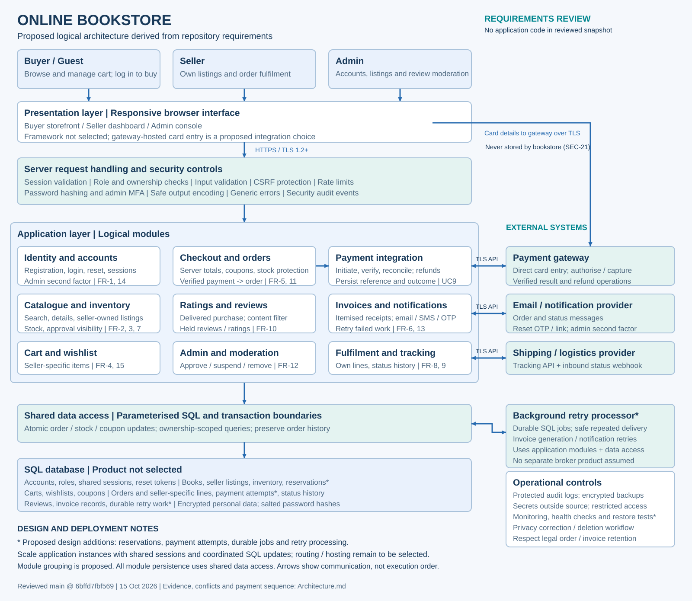

# Online Bookstore architecture review

Reviewed on 15 October 2026 against `main` commit `6bffd7fbf569e35b2f92c016f349f58db00a6b29`.

The supplied architecture is a sound starting point for a layered logical design. It covers the required actors, functional areas, SQL persistence, security controls and external integrations. It cannot be certified as an implemented or production-ready architecture: this snapshot contains specifications and diagrams only, with no application source, database schema, infrastructure configuration or executable tests.

[PNG](ArchitectureDiagram.png) | [Editable diagrams.net source](ArchitectureDiagram.drawio)

## Review scope and evidence

The complete tracked tree was inspected: `.gitignore`, four DOCX documents, their four PDF counterparts, and both use-case diagram files. There was no existing architecture file or README. All 24 PDF pages were text-extracted and read. DOCX paragraph and table text was independently extracted and compared with the PDFs; the substantive text agrees, with differences limited to page furniture, wrapping and a split example email address. The PNG use-case diagram was visually inspected and its draw.io XML examined. Instructions and example actions inside source documents were treated as specification content, not as permission to perform those actions.

| Source | Coverage |
| --- | --- |
| [SRS DOCX](SRS_Online_Bookstore.docx) / [PDF](SRS_Online_Bookstore.pdf) | FR-1 through FR-15; NFR-1 through NFR-12; 2 PDF pages |
| [Security requirements DOCX](SecurityRequirements_Online_Bookstore.docx) / [PDF](SecurityRequirements_Online_Bookstore.pdf) | SEC-1 through SEC-39; proposed policy values; 4 PDF pages |
| [Use-case flows DOCX](UseCaseFlow.docx) / [PDF](UseCaseFlow.pdf) | UC1 through UC16, including alternative and exception flows; 9 PDF pages |
| [Test plan DOCX](TestPlan_Online_Bookstore.docx) / [PDF](TestPlan_Online_Bookstore.pdf) | All 120 planned cases across FR-1 through FR-15; 9 PDF pages; results remain Pending |
| [Use-case PNG](UseCaseDiagram.png) / [draw.io](UseCaseDiagram.drawio) | Buyer, Seller, Admin, Payment Gateway, Email / Notification Service and use-case relationships |

## Architecture decisions

This is a proposed logical decomposition, compatible with a modular application. Boxes do not require independently deployed microservices. The backend framework, SQL product, hosting topology and provider products are unspecified in the repository. Security controls are enforced in server request handling, domain rules, persistence and operations; the diagram's security box is not an assertion that one middleware component can implement all controls.

The revised diagram preserves the supplied design and makes the following responsibilities explicit:

- Card entry goes directly from the browser to gateway-hosted fields or a hosted payment page. This integration mechanism is proposed; direct gateway handling and no bookstore card storage follow SEC-21. The backend sends authoritative amount/currency and handles gateway references and verified outcomes. Card details must not enter application logs.
- Sessions are shared across application instances and support expiry, logout and password-change/reset invalidation. SQL-backed session state is a proposed choice; the repository does not require JWTs or a cache product.
- Checkout coordinates seller-specific stock, coupon redemption and order creation. Reservation records, payment-attempt records and idempotency are proposed mechanisms for handling concurrency and ambiguous gateway outcomes.
- Durable retry work and a background processor support invoice and notification failures. SQL jobs are a proposed implementation; UC10 and UC11 require asynchronous retries, but no broker product is specified. Repeated execution must avoid duplicate invoices, messages, charges or refunds.
- Fulfilment operates on each seller's own order lines. Shipment status history and logistics API/webhook updates feed buyer tracking; API failure displays the last known status with a notice.
- Operational controls cover protected logs, encrypted backups, secrets, privacy requests and retained accounting history. Monitoring, restore tests and health checks are proposed support for availability targets.

### Payment and stock sequence

1. Authenticate the buyer and verify address and cart ownership. Re-read current seller listing visibility, prices and stock; calculate taxes, shipping and discounts on the server.
2. In a short SQL transaction, reserve available stock and coupon capacity for a uniquely identified checkout/payment attempt. Do not create a placed order yet. Release expired reservations through coordinated cleanup. Reservation expiry and late payment success handling require a defined policy.
3. Initiate the gateway operation with the authoritative total, currency and a stable idempotency key. Card entry and any gateway challenge stay with the gateway. Do not keep a SQL transaction open during the network call.
4. Verify success on the server through the provider's authenticated API or authenticated callback, checking the attempt reference, amount and currency. Browser redirect parameters alone are insufficient. Deduplicate repeated callbacks and requests.
5. After verified captured payment, atomically create the order as Placed, retain immutable seller-specific line/price snapshots, convert reservations into stock decrements, record coupon redemption and payment reference, and persist invoice/notification work. A uniqueness constraint links one successful attempt to at most one order.
6. Failed or unknown payment creates no order under SEC-23. Keep the cart and a payment-attempt record for reconciliation. Resolve an unknown result before starting another charge; a blind retry can double-charge the buyer. If capture succeeds but final persistence fails, retry finalisation idempotently or initiate a compensating refund and operational reconciliation. A SQL transaction cannot atomically commit a third-party payment.
7. Generate the invoice and send notifications after order commit. Retry failures without rolling back the paid order. Seller line cancellation initiates an idempotent partial refund and updates invoice/accounting records.

Steps involving reservations, idempotency, compensation and durable jobs are proposed design decisions that close failure-mode gaps in the documents. Provider-specific protocols, timeout values and reconciliation ownership still need implementation decisions.

## Requirements traceability

| Logical area | Repository evidence and required behavior |
| --- | --- |
| Identity and accounts | FR-1, FR-14; UC1, UC2; SEC-1–9, SEC-14. Password policy, adaptive salted hashes, lockout, generic login/reset responses, single-use reset codes, invalidation and admin second factor. |
| Catalogue and inventory | FR-2, FR-3, FR-7; UC3, UC4, UC14; SEC-12, SEC-25–27. Search and pagination, seller-specific price/condition/stock, approved visibility, protected historical references. |
| Cart and wishlist | FR-4, FR-15; UC5, UC6; SEC-11. Guest cart identification, authenticated wishlist, seller-specific lines, quantity checks, unavailable items and moving wishlist items into cart. |
| Checkout and orders | FR-5, FR-11; UC7, UC8; SEC-22–24. Server-calculated totals, coupon limits, stock concurrency and order creation only after verified payment. Test plan FR-5_ST02 covers the last unit race. |
| Payment integration | FR-5; UC9, UC15 alternative 3a; SEC-21, SEC-23, SEC-36. Gateway capture/result verification, unknown outcomes, transaction references and refunds. |
| Invoices and notifications | FR-6, FR-13; UC10, UC11, UC15, UC16; FR-6_IT02, FR-13_IT03, FR-13_ST02 in the test plan. Invoice uniqueness, seller itemisation, refund adjustment, email/SMS, OTP delivery, backoff and retry. |
| Fulfilment and tracking | FR-8, FR-9; UC12, UC15; NFR-11; SEC-11, SEC-12, SEC-36; test plan FR-9_IT01–03 and FR-9_ST02. Seller scope, valid transitions, history, API/webhook updates and fallback. |
| Ratings and reviews | FR-10; UC13; SEC-15, SEC-27, SEC-29; test plan FR-10_ST02. Delivered-order eligibility, validation, duplicate handling, held moderation and aggregate recomputation. |
| Admin and moderation | FR-12; UC16; SEC-10, SEC-13, SEC-14, SEC-29. Account/listing decisions, mandatory reasons, review moderation, audit trail and owner notification. |
| Request and data security | SEC-10–12, SEC-16–19, SEC-24–30. Server authorization, TLS, validation, CSRF, encoding, parameterised SQL and safe errors/logs. |
| Operations and privacy | SEC-20, SEC-31–37. Encrypted backups, protected audit events and retention, minimal collection, privacy notice, correction/deletion requests, retained legal records, authenticated integrations and external secrets. |
| Development and verification | SEC-38, SEC-39; NFR-7, NFR-9. Dependency vulnerability checks, security review before merge, two-week Scrum process and at least 70% unit coverage. These are process obligations, not deployed components. |

### Non-functional validation still required

| Requirement | Architectural implication and verification |
| --- | --- |
| NFR-1 | Measure page loads at up to 500 concurrent users against the 2-second target; tune SQL indexes, pagination and connection limits using measured results. No performance evidence exists yet. |
| NFR-2 | Validate 99.5% monthly availability through monitoring and an appropriate deployment, backup and recovery design. Availability is not established by the logical diagram. |
| NFR-3 | Route requests across replaceable application instances, share session state, coordinate rate limits/jobs and preserve SQL concurrency guarantees. Load-balancing, failover and database capacity remain deployment decisions. |
| NFR-4, NFR-5 | Test a first purchase within 5 minutes and responsive behavior in Chrome, Firefox, Safari and Edge. |
| NFR-6, NFR-8 | TLS 1.2+, encrypted sensitive personal data, adaptive password hashes, gateway-only card handling and SQL transactions. Framework and database product remain unselected. |
| NFR-7, NFR-9 | Apply the documented development process, code/security reviews and coverage gate once application code exists. |
| NFR-10 | Define served regions, data retention, lawful correction/deletion exceptions and privacy workflows. The diagram cannot establish legal compliance. |
| NFR-11 | Select documented provider APIs and verify authenticated TLS integration behavior. |
| NFR-12 | Staff chat/email support to meet the 24-hour response target. This is an operational service obligation; no chat platform is specified. |

## Document inconsistencies and open decisions

The original documents are preserved. The following interpretations are used for this proposed architecture and require source/test alignment before implementation acceptance.

| Issue | Conflicting evidence | Interpretation / action |
| --- | --- | --- |
| Order creation on failed payment | SEC-23 and UC8/UC9 require no order after failure/unknown result; FR-5_IT02 expects an order with Payment Failed status. | Use a separate payment attempt for failure/unknown state; create orders only after verified success. Update the test expectation. |
| Payment versus fulfilment status | UC8 creates Placed; FR-5_IT01 expects Paid; UC15 also mentions Accepted, while FR-9_UT01 permits only the four buyer tracking states. | Model payment status separately from fulfilment/shipment status. Define seller-internal Accepted and line cancellation/refund states and their buyer-facing mapping. |
| New listing visibility | UC14 step 5 requires Pending approval; FR-7_IT01 and FR-7_ST01 expect immediate discoverability. | Require approval before public visibility; add admin approval to those test preconditions/steps. |
| Reset session invalidation | UC2 says old sessions may be invalidated; SEC-9 requires ending all sessions. | Enforce mandatory invalidation after password change/reset, including across scaled instances. |
| Payment detail handling | UC9 step 1 describes the system sending payment details; SEC-21 says card details go directly to the gateway. | Use gateway-hosted card entry and backend references. Adapt UC9 and card-validation tests to that boundary. |
| Review uniqueness and editing | UC13 loads an existing book review for editing; FR-10_IT03 rejects a second review for the same order/book. | Editing an existing review and inserting a duplicate are different operations; decide whether uniqueness is per buyer/book or buyer/order-line before choosing a DB constraint. Delivered eligibility remains mandatory under SEC-15. |
| Review publication and invoice timing | UC13 describes publication but SEC-29 holds flagged reviews; FR-13_ST01 expects immediate invoices while UC10 permits asynchronous retry. | Exclude held reviews from public ratings. Define normal-path invoice timing and an explicit pending/retry state on failure. |
| Tax configuration | FR-13_UT03 permits default/zero tax when configuration is missing. | This is a test expectation, not proof of a valid tax policy. Confirm regional tax behavior before accepting the fallback. |
| Security policy values | Security section 4 proposes 15-minute lockout, 10-minute reset expiry, 5 reset requests/hour, 30-minute idle timeout and 90-day log retention. | Treat these as provisional configuration values, not settled architecture constants. |
| Incomplete use-case context | The use-case actor list and diagram omit logistics, despite NFR-11 and FR-9 integration tests. Notification associations omit several OTP and status paths described in flows/security. | The architecture includes logistics and the complete notification responsibilities. The use-case diagram is not a complete integration inventory. |
| Unresolved operational policy | Provider choice, retry ceilings, reservation expiry, refund reconciliation, backup recovery objectives, hosting/failover and privacy jurisdiction are unspecified. | Decide and validate these during implementation/deployment design. No technologies or completed compliance are asserted by this review. |

## Verification performed

Repository inventory and document parity were checked. All FR/UC areas and security requirement groups were mapped to architectural responsibilities. The generated PNG was visually reviewed; SVG and draw.io sources were parsed as XML. The review also checked diagram references and the absence of modifications to the original source documents. No application tests were run because this repository contains no application or test runner. Pending test-plan rows are planned acceptance criteria, not passing results.
